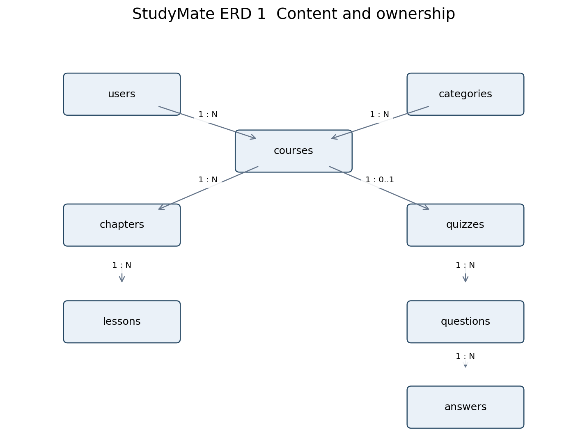
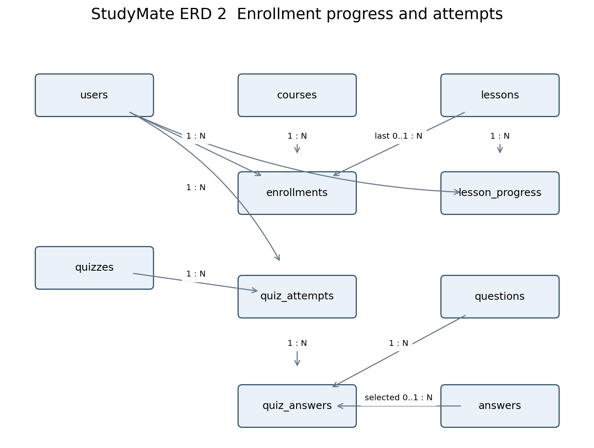

# Thiết kế CSDL StudyMate

Nhóm: Nguyễn Minh Quân — Lê Nguyễn Vạn An — Phạm Văn Tú. Cập nhật27/10/2026. Bản PDF thiết kế để review theo yêu cầu lab; chưa chứng minh đã nộp.

## Kiến trúc

PHP8.3+ sử dụng PDO; đích bàn giao MySQL8.4, InnoDB, utf8mb4. SQLite là chế độ local/test, không thay nghiệm thu MySQL. Nguồn schema thực thi: database/schema.php; dữ liệu mẫu: database/seed.php. Không lưu raw password; session/quota đặt ngoài public.

## Danh mục bảng và toàn vẹn

Có 12 bảng nghiệp vụ; schema PDO và seed PHP, MySQL InnoDB utf8mb4. User thêm auth_version để thu hồi phiên. Session/quota dùng file ngoài public, không thêm bảng framework. SQLite local chỉ phục vụ demo/test, không thay MySQL cuối kỳ.

| **Bảng**        | **Quan hệ và ràng buộc chính**                                                                   |
|-----------------|--------------------------------------------------------------------------------------------------|
| users           | email unique; role student/instructor/admin; is_active; auth_version; không xóa user.            |
| categories      | name unique; một category có nhiều courses; restrict khi đang dùng.                              |
| courses         | instructor_id → users; category_id → categories; status; không xóa sau enrollment.               |
| chapters        | course_id → courses; position; sửa cấu trúc chỉ draft chưa enrollment.                           |
| lessons         | chapter_id → chapters; body, youtube_video_id, position.                                         |
| enrollments     | user_id + course_id unique; last_lesson_id nullable; completed_at nullable.                      |
| lesson_progress | user_id + lesson_id unique; completed_at; không bỏ hoàn thành.                                   |
| quizzes         | course_id unique; một course có tối đa một quiz.                                                 |
| questions       | quiz_id; prompt; explanation; position.                                                          |
| answers         | question_id; text; is_correct; position; bốn lựa chọn/câu.                                       |
| quiz_attempts   | user_id, quiz_id; request_id; submission_hash; điểm do server tính; unique user_id + request_id. |
| quiz_answers    | attempt_id + question_id unique; answer_id nullable; is_correct snapshot.                        |

### BR17 Giao dịch và truy vấn

Enrollment và lesson_progress dùng unique constraint cùng transaction để chống trùng. Nộp quiz ghi attempt, toàn bộ quiz_answers và enrollment.completed_at trong một transaction. Thao tác thay toàn bộ quiz nháp cũng là một transaction; sai một câu phải rollback cả đề.

FK không tự kiểm tra answer thuộc question hoặc last lesson thuộc course; PHP validator/service phải kiểm tra quan hệ này. Lưu timestamps UTC và trả ISO 8601; giao diện hiển thị Asia/Ho_Chi_Minh. Khóa ngoại/index cho các cột lọc user_id, course_id, quiz_id; eager loading để tránh truy vấn theo từng hàng.

### Bảo toàn lịch sử

Xóa course draft dùng cascade cây nội dung/quiz trong transaction và chỉ khi không có enrollment/attempt. Các khóa ngoại từ lịch sử dùng restrict. Không dùng xóa cứng để xử lý user bị khóa hoặc khóa học ngừng tuyển. Không reset/xóa dữ liệu cần giữ.

## Sơ đồ nội dung

## Sơ đồ học tập và lịch sử

## Dữ liệu mẫu và kiểm tra

Hai Student, hai Instructor, một Admin; ba course mẫu gồm published/draft. Mỗi course có hai chapter, mỗi chapter ba lesson, một quiz năm câu với bốn lựa chọn/câu. Setup chỉ seed khi chưa có user, không tự reset dữ liệu.

Bộ14 service checks đã chạy trên SQLite/MySQL, bao gồm unique enrollment, FK category, chấm quiz, tính hoàn thành và bảo toàn kết quả. Bộ mới kiểm tra từ chối POST không đổi12 bảng, phân quyền và roster. Không suy từ kiểm thử chức năng sang hiệu năng hoặc mọi race condition. Xem QUAN_TEST_REPORT.md.

## Các điểm phải giữ

- FK bảo đảm tham chiếu nhưng quan hệ answer–question, lesson–course còn được kiểm ở service.
- Enrollment/progress/attempt có unique tương ứng; hoàn thành khóa ghi một lần và không mất khi làm lại thấp điểm.
- Không thay schema trên DB có dữ liệu bằng reset; mọi migration sau này phải được Tú review.
- Backup/restore và performance gate là việc của Tú cần xác nhận trước bản nộp cuối.
