# StudyMate — Báo cáo kiểm thử thủ công của Quân

- Người kiểm thử: Nguyễn Minh Quân — MSSV 52400227.
- Thời gian: 15–17/10/2026 (Asia/Ho_Chi_Minh); kết quả từng đợt được tách riêng.
- Mã nguồn: https://github.com/minhquan006/StudyMate
- Nhánh làm việc đợt 15–16/10: `fix/instructor-workflow`.
- Môi trường: macOS, PHP local tại `http://localhost:8001`, PDO MySQL, trình duyệt Chrome.
- Model thiết lập cho đợt kiểm thử AI: `gemini-3.5-flash-lite`.
- Phương pháp: thao tác thủ công trên giao diện; đối chiếu ảnh, nhật ký và xác nhận của người kiểm thử. Không bao gồm kết quả chạy bộ kiểm thử tự động.

## 1. Dữ liệu kiểm thử

| Thành phần | Giá trị |
| --- | --- |
| Khóa kiểm thử | ID 4 — Kiểm thử Instructor 15-10 đã chỉnh sửa |
| Chủ khóa | `instructor1@studymate.test` |
| Instructor không sở hữu khóa | `instructor2@studymate.test` |
| Học viên đã ghi danh | `student2@studymate.test` |
| Học viên chưa ghi danh khóa ID 4 | `student1@studymate.test` |
| Quản trị viên | `admin@studymate.test` |
| Nội dung | 1 chương, 1 bài học, quiz 5 câu; ngưỡng đạt 70% |
| Điểm dùng để kiểm tra bảo toàn kết quả | Lần đầu 80%; lần làm lại 60%; điểm tốt nhất giữ 80% |

Không ghi API key hoặc mật khẩu kết nối CSDL vào báo cáo. `config.php` là cấu hình riêng trên máy, không được Git theo dõi.

## 2. Quy ước bằng chứng

- **NK**: kết quả trong nhật ký `QA_Quan.md` do người kiểm thử cung cấp.
- **XN**: người kiểm thử xác nhận đạt trong phiên hướng dẫn; chưa có ảnh riêng trong bộ ảnh tham chiếu ở mục 7.
- **A1–A6**: ảnh đợt 15–16/10 đã đối chiếu, được liệt kê ở mục 7.
- **B1–B12**: ảnh đợt 17/10 đã đối chiếu, được nhúng ở mục 10; không dùng chung mã với các ca kiểm thử.
- **Đạt giao diện**: chỉ xác nhận giao diện; chưa kết luận về yêu cầu POST được sửa trực tiếp.

Các ca có nguồn XN là kết quả người kiểm thử báo lại, không phải thao tác được công cụ kiểm thử tự động thực hiện. Nguồn bằng chứng của từng ca được ghi riêng trong bảng.

## 3. Instructor và luồng học tập

| Mã | Thao tác | Kết quả mong đợi | Kết quả thực tế | Đánh giá | Nguồn |
| --- | --- | --- | --- | --- | --- |
| Q-I01 | Tạo khóa mới | Lưu ở trạng thái draft | Tạo khóa ID 4, hiển thị Bản nháp | Đạt | NK |
| Q-I02 | Sửa thông tin khóa và tải lại | Lưu bền thông tin mới | Tên khóa được sửa thành Kiểm thử Instructor 15-10 đã chỉnh sửa; tải lại vẫn giữ thông tin đã lưu | Đạt | XN |
| Q-I05a | Xuất bản khóa chưa có chương | Từ chối, giữ draft | Báo “Khóa cần ít nhất một chương.”; vẫn Bản nháp | Đạt | NK |
| Q-I05b | Xuất bản khóa có chương chưa có bài | Từ chối, giữ draft | Báo “Mỗi chương cần ít nhất một bài.”; vẫn Bản nháp | Đạt | NK |
| Q-I05c | Xuất bản khi chưa có quiz hợp lệ | Từ chối, giữ draft | Báo “Cần quiz hợp lệ với ít nhất 5 câu.”; vẫn Bản nháp | Đạt | NK |
| Q-I06a | Xuất bản khóa đủ nội dung và quiz | Chuyển sang published | Hiển thị “Đã cập nhật trạng thái.” và “Đã xuất bản” | Đạt | NK |
| Q-I06b | Tìm khóa đã xuất bản trong danh sách công khai | Hiển thị khóa đã xuất bản | Tìm thấy đúng 1 khóa với tên và mô tả đã lưu | Đạt | NK |
| Q-I07 | Instructor khác mở trang sửa khóa ID 4 | Từ chối, không hiện form sửa | Giảng viên thứ hai nhận “Không tìm thấy khóa học.” | Đạt | NK |
| Q-E01 | Student2 ghi danh và mở khóa ID 4 | Truy cập được bài học | Hiển thị bài Giới thiệu khóa học, tiến độ ban đầu 0% | Đạt | NK |
| Q-I08a | Đưa khóa đã có enrollment về nháp | Từ chối, giữ published | Báo “Chỉ đưa published chưa enrollment về nháp.” | Đạt | NK |
| Q-I08b | Mở tab Nội dung sau khi có enrollment | Khóa thao tác đổi cấu trúc trên giao diện | Báo cấu trúc đã đóng; không có form thêm bài và nút xóa | Đạt giao diện | NK |
| Q-Q00 | Mở quiz trước khi hoàn thành đủ bài | Chặn truy cập/làm quiz | Người kiểm thử xác nhận bị chặn khi chưa hoàn thành đủ bài | Đạt | XN |
| Q-Q01 | Nộp quiz đúng 4/5 câu | Điểm 80%, đạt ngưỡng 70% | Hiển thị 80%, Đạt, ngưỡng 70% | Đạt | NK |
| Q-C01 | Hoàn thành đủ bài và đạt quiz | Ghi nhận hoàn thành khóa | Dashboard hiển thị tiến độ 100%, đã hoàn thành, điểm tốt nhất 80% | Đạt | NK |
| Q-Q02 | Làm lại đúng 3/5 câu, bỏ trống 2 câu | Điểm 60%, chưa đạt | Hiển thị 60%, chưa đạt | Đạt | XN |
| Q-C02 | Xem Dashboard sau lần làm lại điểm thấp | Giữ hoàn thành và điểm tốt nhất | Tiến độ 100%, đã hoàn thành, điểm tốt nhất 80% | Đạt | XN |
| Q-I09 | Chủ khóa xem danh sách học viên khóa ID 4 | Hiển thị đúng kết quả học tập | Học viên thứ hai: tiến độ 100%, điểm tốt nhất 80, hoàn thành Có | Đạt | XN |

## 4. Admin — danh mục và tài khoản

| Mã | Thao tác | Kết quả mong đợi | Kết quả thực tế | Đánh giá | Nguồn |
| --- | --- | --- | --- | --- | --- |
| Q-A01 | Tạo Danh mục kiểm thử Quân | Danh mục mới xuất hiện | Người kiểm thử xác nhận tạo thành công | Đạt | XN |
| Q-A02 | Đổi tên thành Danh mục kiểm thử Quân đã sửa, tải lại | Giữ tên mới | Người kiểm thử xác nhận tên mới được lưu | Đạt | XN |
| Q-A03 | Xóa danh mục kiểm thử chưa được sử dụng | Danh mục biến mất sau khi tải lại | Người kiểm thử xác nhận xóa thành công | Đạt | XN |
| Q-A04 | Xóa danh mục đang có khóa học sử dụng | Từ chối xóa | Hiển thị “Danh mục đang được sử dụng.”; người kiểm thử xác nhận bước đạt | Đạt | A1, XN |
| Q-A05 | Khóa Student2, tải lại trang Student trong phiên đang mở | Phiên cũ không được vào khu vực học viên | Báo “Phiên đăng nhập không hợp lệ hoặc tài khoản đã bị khóa.”; không hiện Dashboard | Đạt | A2 |
| Q-A06 | Đăng nhập Student2 khi tài khoản đang bị khóa | Từ chối đăng nhập | Hiển thị “Tài khoản đã bị khóa.” | Đạt | A3 |
| Q-A07 | Mở khóa Student2 rồi đăng nhập lại | Đăng nhập được, bảo toàn kết quả | Đăng nhập thành công, Dashboard còn 1 khóa đã hoàn thành; người kiểm thử xác nhận tiến độ 100% và điểm tốt nhất 80% | Đạt | A4, XN |

## 5. Lưu trữ và xuất bản lại khóa học

| Mã | Thao tác | Kết quả mong đợi | Kết quả thực tế | Đánh giá | Nguồn |
| --- | --- | --- | --- | --- | --- |
| Q-A08 | Admin lưu trữ khóa ID 4 đang published | Chuyển sang archived | Người kiểm thử xác nhận trạng thái Đã lưu trữ | Đạt | XN |
| Q-A09 | Tìm khóa ID 4 trong danh sách công khai sau lưu trữ | Khóa không xuất hiện | Người kiểm thử xác nhận không còn thấy khóa trong danh sách | Đạt | XN |
| Q-A10 | Student1 mở đường dẫn giới thiệu đã lưu của khóa archived | Không thể ghi danh mới | Người kiểm thử xác nhận không thể ghi danh mới qua đường dẫn cũ | Đạt | XN |
| Q-A11 | Student2 đã ghi danh mở lại bài học và quiz của khóa archived | Tiếp tục học, giữ kết quả | Người kiểm thử xác nhận vẫn truy cập được bài học/quiz và giữ tiến độ, điểm, trạng thái hoàn thành | Đạt | XN |
| Q-I10 | Chủ khóa xuất bản lại khóa ID 4 từ archived | Chuyển sang published nếu đủ điều kiện | Người kiểm thử xác nhận trạng thái Đã xuất bản | Đạt | XN |
| Q-I11 | Student1 xem danh sách và trang giới thiệu sau xuất bản lại | Khóa xuất hiện và có lựa chọn ghi danh | Người kiểm thử xác nhận khóa xuất hiện, mở được trang giới thiệu và có lựa chọn ghi danh; chưa bấm ghi danh trong ca này | Đạt giao diện | XN |
| Q-C03 | Student2 xem kết quả sau xuất bản lại | Bảo toàn kết quả học tập | Người kiểm thử xác nhận tiến độ 100%, điểm tốt nhất 80%, đã hoàn thành | Đạt | XN |

## 6. AI/Gemini

| Mã | Thao tác | Kết quả mong đợi | Kết quả thực tế | Đánh giá | Nguồn |
| --- | --- | --- | --- | --- | --- |
| Q-AI01 | Tắt AI/chưa điền key rồi bấm Tóm tắt | Thông báo chưa cấu hình, không làm mất nội dung học | Hiển thị “AI chưa được cấu hình. Học và quiz vẫn hoạt động.”; bài học vẫn hiển thị, tiến độ 100% | Đạt | A5 |
| Q-AI02 | Mở bài học và quiz sau lỗi chưa cấu hình AI | Luồng học và quiz tiếp tục hoạt động | Người kiểm thử xác nhận vẫn truy cập được, kết quả hoàn thành được giữ | Đạt | XN |
| Q-AI03 | Bật AI với key local hợp lệ, dùng Tóm tắt | Trả bản tóm tắt tiếng Việt bám sát bài | Người kiểm thử xác nhận đạt; ảnh A6 minh chứng một phản hồi AI thành công, không phân biệt riêng nút đã dùng | Đạt | XN; A6 minh chứng chung |
| Q-AI04 | Gửi câu hỏi về các bước người học cần thực hiện | Nêu đọc nội dung, đánh dấu hoàn thành và làm quiz | Người kiểm thử xác nhận câu trả lời đúng nội dung; ảnh A6 có phản hồi phù hợp mục tiêu bài học | Đạt | XN; A6 minh chứng chung |
| Q-AI05 | Hỏi học phí chính xác theo bài học không có thông tin học phí | Nói rõ thiếu dữ liệu, không tự nêu con số | Người kiểm thử xác nhận đạt | Đạt | XN |
| Q-AI06 | Gửi câu hỏi trống | Từ chối dữ liệu không hợp lệ | Người kiểm thử xác nhận báo “Câu hỏi cần 1–1.000 ký tự.” | Đạt | XN |
| Q-AI07 | Gửi 6 yêu cầu hợp lệ trong cùng một phút đồng hồ, không có lượt gọi từ cửa sổ khác | 5 lượt đầu trả lời; lượt 6 bị giới hạn tại ứng dụng | Người kiểm thử xác nhận báo “Hết quota AI. Vui lòng thử lại sau.” ở lượt vượt giới hạn | Đạt | XN |
| Q-AI08 | Mở bài học và quiz khi AI bị giới hạn lượt | Học và quiz vẫn sử dụng được | Người kiểm thử xác nhận truy cập bình thường, tiến độ không đổi | Đạt | XN |
| Q-AI09 | Gửi lại 1 yêu cầu khi sang phút tiếp theo | Trả lời trở lại nếu còn hạn mức ngày và provider | Người kiểm thử xác nhận AI hoạt động trở lại | Đạt | XN |

Thông báo “Provider đã hết quota miễn phí.” thuộc hạn mức của Google, khác với giới hạn tại ứng dụng. Q-AI07 xác nhận hành vi trong kịch bản một học viên gọi lần lượt; chưa kiểm tra cạnh tranh nhiều tài khoản.

## 7. Ảnh tham chiếu

Sáu ảnh minh chứng được lưu tại `docs/images/qa-quan/` và hiển thị bên dưới. Các ảnh được chép nguyên bản từ ảnh người kiểm thử cung cấp.

| Mã ảnh | Tệp minh chứng | Nội dung quan sát được |
| --- | --- | --- |
| A1 | [A1-category-in-use.png](images/qa-quan/A1-category-in-use.png) | Admin nhận thông báo danh mục đang được sử dụng |
| A2 | [A2-session-revoked.png](images/qa-quan/A2-session-revoked.png) | Trang Student chặn phiên không hợp lệ/tài khoản bị khóa |
| A3 | [A3-account-locked.png](images/qa-quan/A3-account-locked.png) | Đăng nhập bị từ chối vì tài khoản đã bị khóa |
| A4 | [A4-account-unlocked.png](images/qa-quan/A4-account-unlocked.png) | Student2 đăng nhập thành công sau mở khóa; còn 1 khóa đã hoàn thành |
| A5 | [A5-ai-disabled.png](images/qa-quan/A5-ai-disabled.png) | Chưa cấu hình AI; bài học hiển thị và tiến độ 100% |
| A6 | [A6-ai-response.png](images/qa-quan/A6-ai-response.png) | Khung AI hiển thị phản hồi tiếng Việt đúng nội dung mục tiêu bài học |

### A1 — Chặn xóa danh mục đang sử dụng

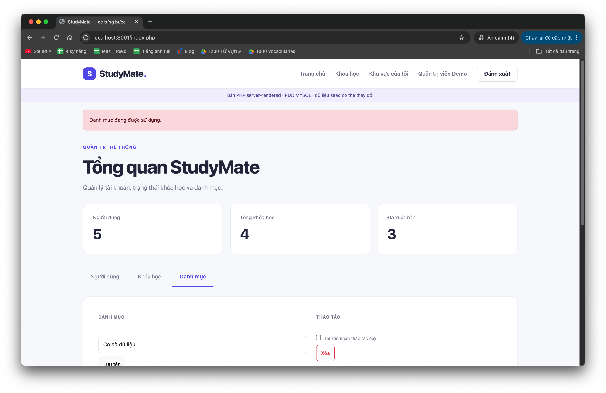

### A2 — Thu hồi phiên đăng nhập

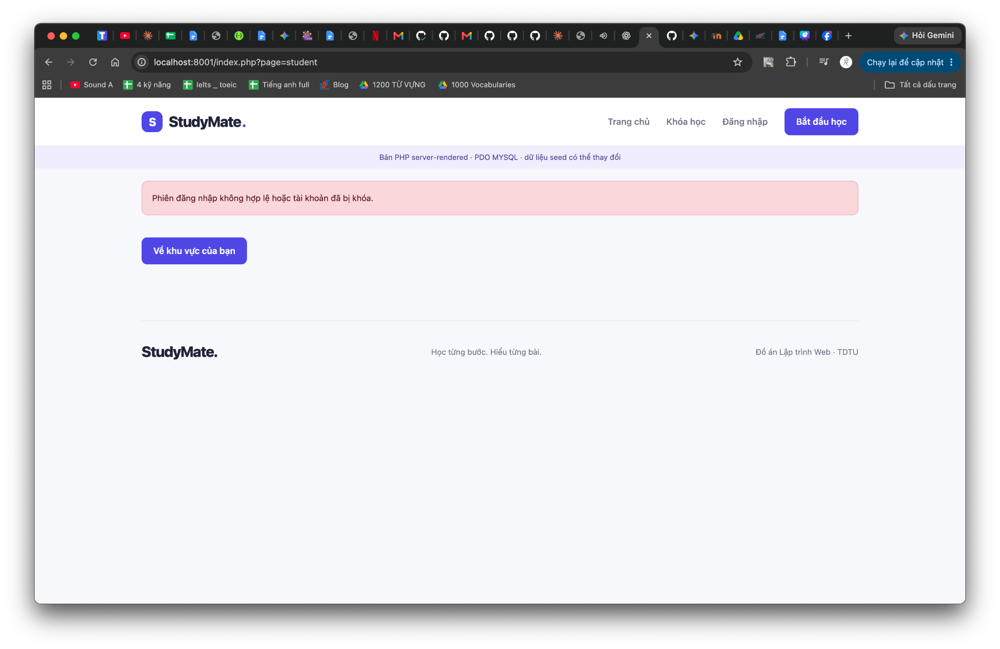

### A3 — Chặn đăng nhập tài khoản bị khóa

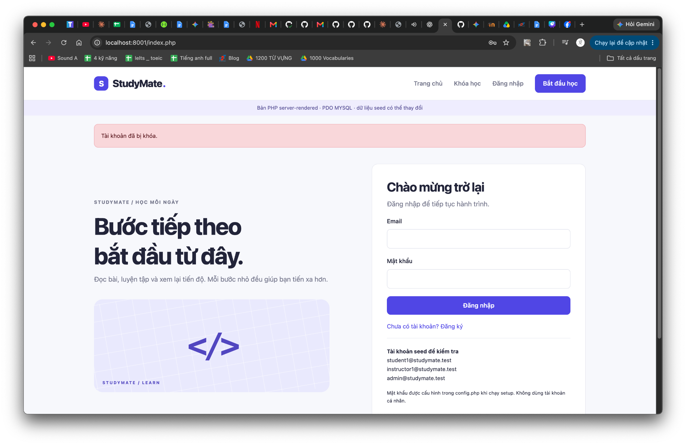

### A4 — Đăng nhập sau mở khóa

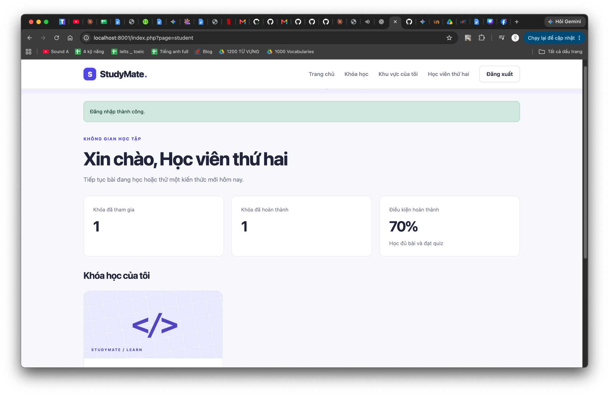

### A5 — AI chưa cấu hình

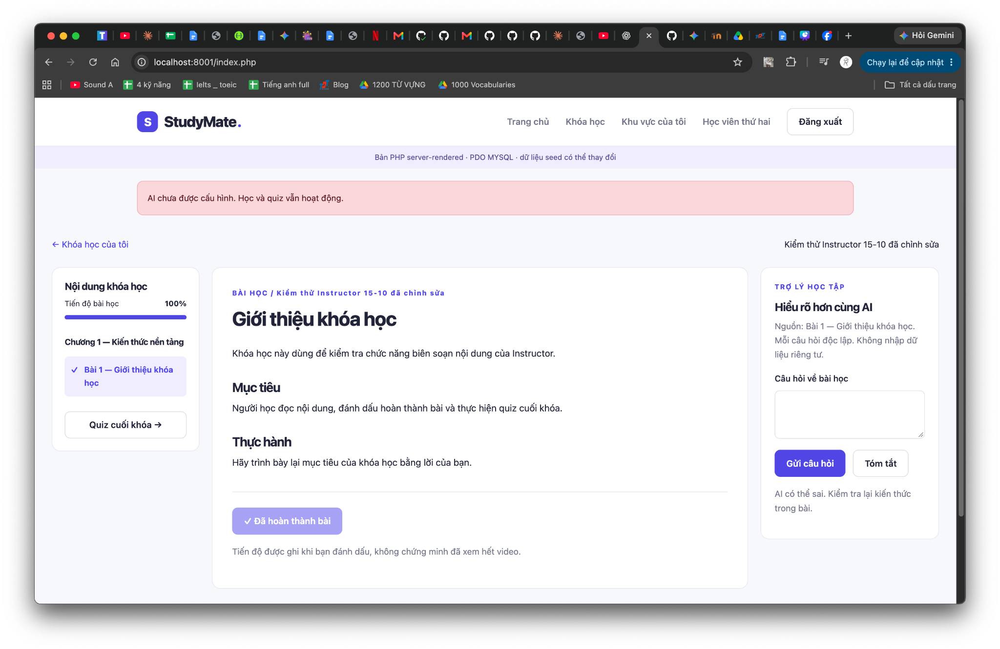

### A6 — AI phản hồi thành công

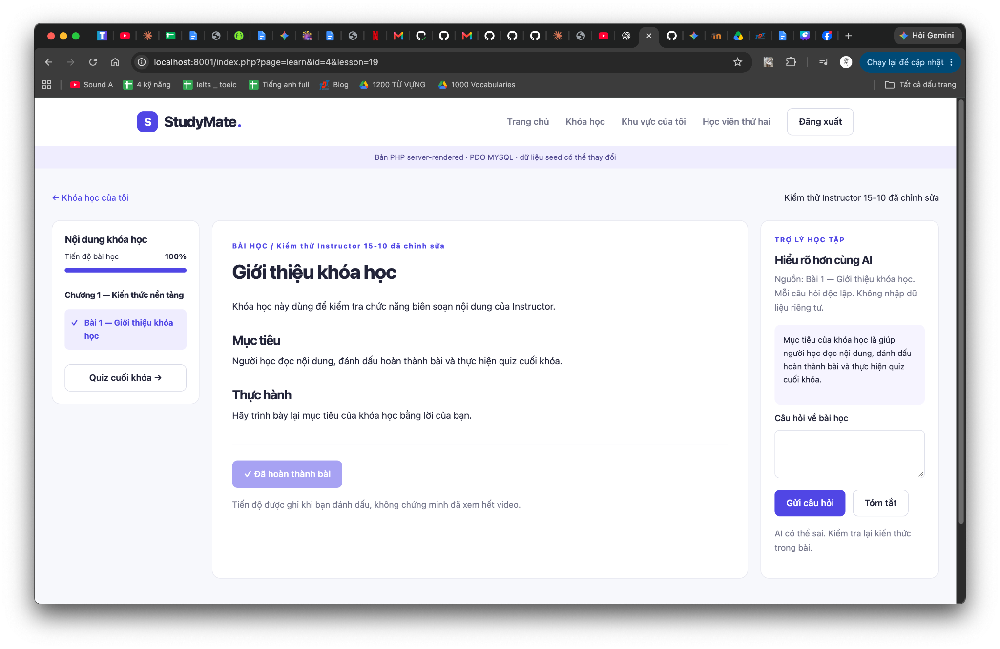

Các ảnh A1–A6 đối chiếu thông báo ở mức giao diện, không chụp mã HTTP hoặc log request. Mục 10 bổ sung ảnh Console có mã HTTP cho các ca ngày 17/10.

## 8. Phạm vi cần kiểm tra bổ sung

Các ca trong báo cáo xác nhận những luồng đã thao tác, chưa đại diện cho nghiệm thu toàn bộ dự án. Danh sách dưới đây được cập nhật sau phần bổ sung ngày 17/10 ở mục 10; các mục sau vẫn chưa được xác nhận:

- Gửi POST trực tiếp xóa chương/bài hoặc đổi thứ tự bài sau enrollment; giả mạo ID hoặc role trong các yêu cầu ghi dữ liệu. Đã kiểm tra POST thêm chương, đổi thứ tự chương và POST lưu quiz bị khóa ở mục 10.
- Kiểm tra các thao tác biên soạn ở các trạng thái chưa được thử, nhất là published/archived chưa có enrollment. CRUD chương/bài và biên soạn quiz trên khóa draft chưa enrollment đã được bổ sung ở mục 10.
- Các giới hạn độ dài tối đa của prompt/lựa chọn/giải thích, chỉ số đáp án đúng ngoài phạm vi, toàn bộ handler POST với CSRF sai và các yêu cầu đồng thời. Đã kiểm tra số câu 4/5/20/21, năm trường hợp dữ liệu sai và hai trường hợp CSRF tại action quiz_save ở mục 10.
- Kiểm tra thêm nhiều phiên/tài khoản đồng thời cho cơ chế thu hồi phiên. Ca khóa rồi mở khóa trước khi phiên Student cũ tải lại đã được người kiểm thử xác nhận đạt ngày 16/10; xem Q-A12 ở mục 10.
- AI với câu hỏi vượt 1.000 ký tự ở phía server, API key sai, timeout, mất mạng, giới hạn 20 lượt/ngày/người và 100 lượt/ngày/toàn ứng dụng.
- Giới hạn AI toàn ứng dụng khi nhiều tài khoản gọi đồng thời; khả năng chống chèn chỉ dẫn trong nội dung bài học.
- Kiểm thử hồi quy đầy đủ trên bản main sau khi merge và trên môi trường khác.

## 9. Thay đổi đi kèm đợt kiểm thử

- `config.example.php`: đổi model mặc định từ `gemini-2.5-flash-lite` sang `gemini-3.5-flash-lite`; giữ `ai_enabled=false` và `gemini_api_key=''`.
- `docs/QA_Quan.md`: lưu kết quả kiểm thử thủ công, nguồn bằng chứng và phạm vi còn cần kiểm tra.
- Theo kết quả `git status` trên máy kiểm thử, lần cập nhật này chưa có thay đổi mã xử lý Instructor, Admin hoặc AI. Báo cáo không khẳng định đã sửa lỗi mã nguồn trong nhánh này.

## 10. Bổ sung kiểm thử ngày 17/10/2026

### 10.1. Phạm vi và cách ghi nhận

- Người thao tác: Nguyễn Minh Quân; hướng dẫn và đối chiếu ảnh có Codex hỗ trợ.
- Môi trường được thể hiện trong ảnh: Chrome trên macOS, web local `http://localhost:8001`, giao diện ghi PDO MySQL. Không chạy bộ kiểm thử tự động mới trong đợt này.
- Khóa ID 4 đang published và đã có Student2 ghi danh, dùng để kiểm tra khóa cấu trúc và quiz.
- Khóa ID 5 — Kiểm thử CRUD nháp 17-10 — dùng riêng cho CRUD/quiz, giữ draft và không ghi danh; đã xóa ở cuối đợt.
- SHA của bản source đang chạy trên máy ngày 17/10 chưa được thu thập. Không mặc định các kết quả này là kiểm thử tích hợp lại trên commit main mới nhất.
- Mã HTTP 409/422/419 trong các ca POST lấy từ Console `fetch()`; thông báo đúng true là phép đối chiếu chuỗi HTML trả về.
- Q-A12 ghi bổ sung kết quả người kiểm thử xác nhận ngày 16/10; các ca còn lại trong bảng dưới thực hiện ngày 17/10.
- Ảnh B7 thể hiện Câu 20 ở trang sau lưu; ảnh B8 có lệnh đếm 5 tại URL không có count. Ảnh chỉ đếm form khi URL có count không được dùng làm bằng chứng lưu bền.

### 10.2. Kết quả bổ sung

| Mã | Thao tác | Kết quả mong đợi | Kết quả thực tế | Đánh giá | Nguồn |
| --- | --- | --- | --- | --- | --- |
| Q-A12 | Khóa rồi mở Student2 trước khi cửa sổ Student cũ tải lại | Phiên cũ vẫn bị từ chối; đăng nhập mới được phép | Người kiểm thử xác nhận đạt ngày 16/10; không có ảnh riêng trong bộ B1–B12 | Đạt | XN |
| Q-I12 | Gửi POST chapter_save tạo chương vào khóa ID 4 đang published và đã có enrollment | Từ chối tại server; không thêm chương | Console HTTP 409, thông báo “Cấu trúc chỉ sửa khi bản nháp chưa có enrollment.” khớp; trang vẫn hiện chương cũ | Đạt | B1 |
| Q-I13 | Đổi thứ tự chương khóa ID 4 từ 1 sang 2 rồi lưu | Từ chối; tải lại vẫn là 1 | Người kiểm thử xác nhận bị chặn và thứ tự vẫn là 1 | Đạt | XN |
| Q-I14 | Gửi POST quiz_save với nội dung quiz hiện có của khóa ID 4 | Từ chối tại server khi quiz đã khóa | Console HTTP 409, thông báo khóa cấu trúc khớp; giao diện ghi Quiz đã khóa, chỉ xem | Đạt | B2 |
| Q-D01 | Tạo khóa Kiểm thử CRUD nháp 17-10 | Tạo draft để thử CRUD, chưa xuất bản/ghi danh | Tạo khóa ID 5; ảnh B8 ghi trạng thái Bản nháp | Đạt | B3, B8; XN |
| Q-D02 | Thêm chương A thứ tự 1 và chương B thứ tự 2 | Lưu hai chương và sắp A trước B | Người kiểm thử thực hiện; ảnh sau chỉnh sửa B3 thể hiện đủ hai chương | Đạt | XN; B3 minh chứng tồn tại |
| Q-D03 | Sửa tên chương A và chuyển thứ tự thành 3 | Giữ tên mới; chương B thứ tự 2 đứng trước A thứ tự 3 | Ảnh hiển thị đúng tên Chương A — Đã chỉnh sửa và thứ tự B=2, A=3 | Đạt | B3 |
| Q-D04 | Thêm bài B1 thứ tự 1 và B2 thứ tự 2 vào chương B | Lưu được cả hai bài trong đúng chương | Ảnh sau chỉnh sửa B4 cho thấy cả hai bài thuộc chương B | Đạt | XN; B4 minh chứng tồn tại |
| Q-D05 | Sửa tiêu đề và nội dung bài B1 | Lưu tiêu đề và body mới | Ảnh B4 giữ tiêu đề Bài B1 — Đã chỉnh sửa; người kiểm thử xác nhận nội dung mới | Đạt | B4, XN |
| Q-D06 | Đổi thứ tự bài B1 thành 3 | B2 thứ tự 2 đứng trước B1 thứ tự 3 | Danh sách hiển thị đúng B2 trước B1 với thứ tự 2 và 3 | Đạt | B4 |
| Q-D07 | Mở Xem tại B1 sau chỉnh sửa | Trang preview hiển thị body mới | Người kiểm thử xác nhận thấy Nội dung đã chỉnh sửa và đoạn văn cập nhật | Đạt | XN |
| Q-D08 | Xóa riêng bài B2, tải lại | B2 mất; B1 và hai chương còn lại | Người kiểm thử xác nhận đạt; không có ảnh riêng trong bộ B1–B12 | Đạt | XN |
| Q-D09 | Xóa chương B đang chứa B1 | Chương B và B1 mất, chương A còn lại | Người kiểm thử xác nhận đạt; đây là đối chiếu giao diện, chưa truy vấn DB để kiểm bản ghi mồ côi | Đạt | XN |
| Q-D10 | Mở lại đường dẫn preview B1 sau xóa chương B | Không truy cập được bài đã xóa | Người kiểm thử xác nhận báo Không tìm thấy bài học; chưa thu mã HTTP | Đạt | XN |
| Q-D11 | Tạo quiz 5 câu trên khóa nháp ID 5, tải lại | Giữ đủ câu, bốn lựa chọn và đáp án đúng | Người kiểm thử xác nhận lưu được; các ảnh B5/B8 thể hiện form quiz sau lưu | Đạt | XN, B5, B8 |
| Q-D12 | Sửa prompt và giải thích câu 1, giữ đáp án A | Lưu thay đổi khi khóa còn draft chưa enrollment | Ảnh thể hiện prompt mới, giải thích mới và đáp án Instructor được chọn | Đạt | B5 |
| Q-D13 | Gửi POST quiz_save có 4 câu | HTTP 422; báo Quiz cần 5–20 câu. | Console ghi số câu 4, HTTP 422, thông báo đúng true | Đạt | B6 |
| Q-D14 | Gửi POST quiz_save có 21 câu | HTTP 422; báo Quiz cần 5–20 câu. | Console ghi số câu 21, HTTP 422, thông báo đúng true | Đạt | B6 |
| Q-D15 | Mở rộng quiz từ 5 lên 20, điền 15 câu hợp lệ, lưu | Chấp nhận mức tối đa 20 câu và giữ sau khi mở lại | Ảnh tại URL không có count hiển thị đến Câu 20 với nội dung mẫu; không có ảnh riêng kết quả lệnh đếm 20 hoặc truy vấn DB | Đạt ở mức trang sau lưu | B7 |
| Q-D16 | Giảm quiz từ 20 về 5, lưu rồi mở URL không có count | Lưu bền 5 câu đầu; không còn 15 câu bổ sung | Ảnh báo Đã lưu toàn bộ quiz; URL không có count; Console đếm 5; người kiểm thử đã thực hiện thao tác giảm | Đạt | B8 |
| Q-D17 | Gửi câu 1 chỉ có 3 lựa chọn | HTTP 422; thông báo mỗi câu cần bốn lựa chọn | Console HTTP 422, thông báo đúng true | Đạt | B9 |
| Q-D18 | Gửi câu 1 có 5 lựa chọn | HTTP 422; thông báo mỗi câu cần bốn lựa chọn | Console HTTP 422, thông báo đúng true | Đạt | B9 |
| Q-D19 | Gửi câu 1 thiếu trường correct | HTTP 422; yêu cầu một đáp án đúng | Console HTTP 422, thông báo đúng true | Đạt | B9 |
| Q-D20 | Gửi prompt câu 1 là abc (3 ký tự) | HTTP 422; từ chối prompt quá ngắn | Console HTTP 422, thông báo đúng true | Đạt | B9 |
| Q-D21 | Gửi một lựa chọn trống | HTTP 422; báo Mỗi lựa chọn cần 1–250 ký tự. | Console HTTP 422, thông báo đúng true | Đạt | B9 |
| Q-D22 | POST lưu quiz với dữ liệu hợp lệ nhưng thiếu csrf | HTTP 419; báo CSRF token không hợp lệ | Console ghi Thiếu CSRF, HTTP 419, thông báo đúng true | Đạt | B10 |
| Q-D23 | POST lưu quiz với csrf=invalid-token | HTTP 419; báo CSRF token không hợp lệ | Console ghi Sai CSRF, HTTP 419, thông báo đúng true | Đạt | B10 |
| Q-D24 | Dùng Xóa nháp trên khóa thử ID 5 chưa có enrollment | Xóa được khóa thử | Sau thao tác xóa, mở lại trang quản lý ID 5 nhận Không tìm thấy khóa học; không có ảnh riêng thông báo xóa thành công | Đạt ở mức truy cập sau xóa | B11 |
| Q-D25 | Mở lại /index.php?page=edit&id=5 sau xóa | Không hiện form quản lý của khóa đã xóa | Ảnh hiển thị Không tìm thấy khóa học; chưa thu mã HTTP cho GET này | Đạt | B11 |
| Q-D26 | Mở quản lý khóa ID 4 sau khi xóa ID 5 | Khóa khác vẫn tồn tại và mở được | Ảnh hiển thị tên khóa ID 4 và trạng thái Đã xuất bản; chưa kiểm lại dữ liệu Student2 trong ca này | Đạt trong phạm vi mở quản lý | B12 |

### 10.3. Ảnh minh chứng bổ sung

Các ảnh dưới đây được chép nguyên bản, không chỉnh sửa nội dung hoặc thanh địa chỉ. Thư mục: `docs/images/qa-quan/2026-10-17/`.

| Mã ảnh | Tệp | Nội dung quan sát được |
| --- | --- | --- |
| B1 | [B1-chapter-post-blocked.png](images/qa-quan/2026-10-17/B1-chapter-post-blocked.png) | Chặn POST thêm chương: HTTP 409, thông báo đúng true |
| B2 | [B2-quiz-post-blocked.png](images/qa-quan/2026-10-17/B2-quiz-post-blocked.png) | Chặn POST lưu quiz đã khóa: HTTP 409, thông báo đúng true |
| B3 | [B3-draft-chapter-order.png](images/qa-quan/2026-10-17/B3-draft-chapter-order.png) | Khóa nháp ID 5: chương B thứ tự 2, chương A đã sửa thứ tự 3 |
| B4 | [B4-draft-lesson-order.png](images/qa-quan/2026-10-17/B4-draft-lesson-order.png) | Chương B: bài B2 thứ tự 2 đứng trước bài B1 đã sửa thứ tự 3 |
| B5 | [B5-draft-quiz-edited.png](images/qa-quan/2026-10-17/B5-draft-quiz-edited.png) | Câu 1 có prompt và giải thích mới; chọn Instructor là đáp án đúng |
| B6 | [B6-quiz-count-rejected.png](images/qa-quan/2026-10-17/B6-quiz-count-rejected.png) | Quiz 4 và 21 câu: HTTP 422, thông báo đúng true |
| B7 | [B7-quiz-20-questions.png](images/qa-quan/2026-10-17/B7-quiz-20-questions.png) | Trang quiz tại URL không có count hiển thị nội dung đến Câu 20 |
| B8 | [B8-quiz-reduced-to-5.png](images/qa-quan/2026-10-17/B8-quiz-reduced-to-5.png) | Lưu quiz thành công; URL không có count; Console đếm 5 câu |
| B9 | [B9-quiz-invalid-data.png](images/qa-quan/2026-10-17/B9-quiz-invalid-data.png) | Năm trường hợp dữ liệu quiz sai: HTTP 422, thông báo đúng true |
| B10 | [B10-quiz-csrf-rejected.png](images/qa-quan/2026-10-17/B10-quiz-csrf-rejected.png) | Thiếu và sai CSRF khi lưu quiz: HTTP 419, thông báo đúng true |
| B11 | [B11-draft-course-deleted.png](images/qa-quan/2026-10-17/B11-draft-course-deleted.png) | Mở lại trang quản lý ID 5: Không tìm thấy khóa học |
| B12 | [B12-other-course-preserved.png](images/qa-quan/2026-10-17/B12-other-course-preserved.png) | Khóa ID 4 vẫn mở được, tên giữ nguyên và trạng thái Đã xuất bản |

#### B1 — Chặn POST thêm chương: HTTP 409, thông báo đúng true

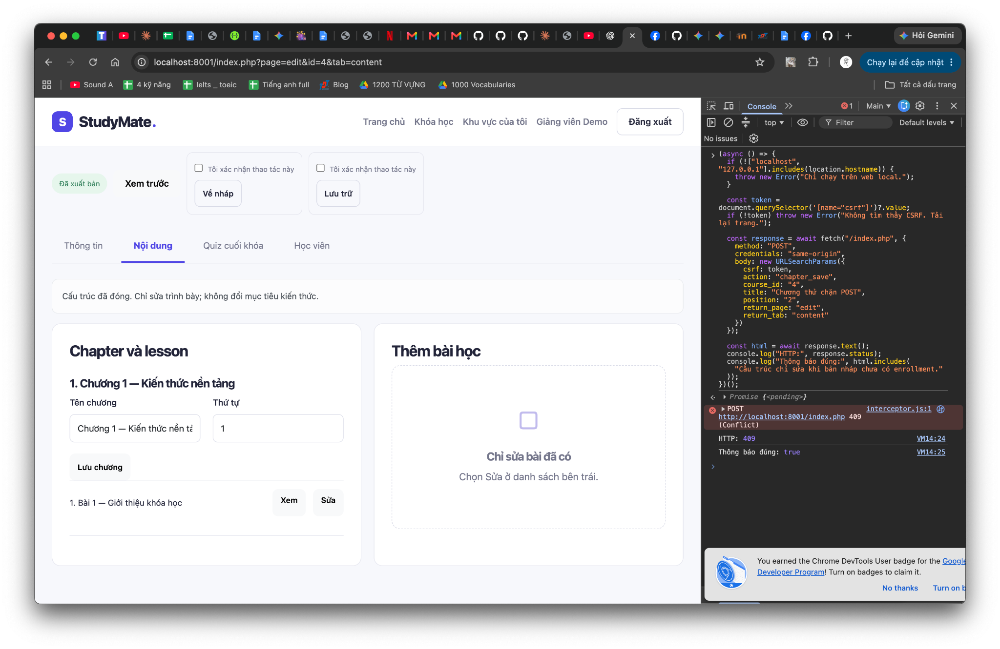

#### B2 — Chặn POST lưu quiz đã khóa: HTTP 409, thông báo đúng true

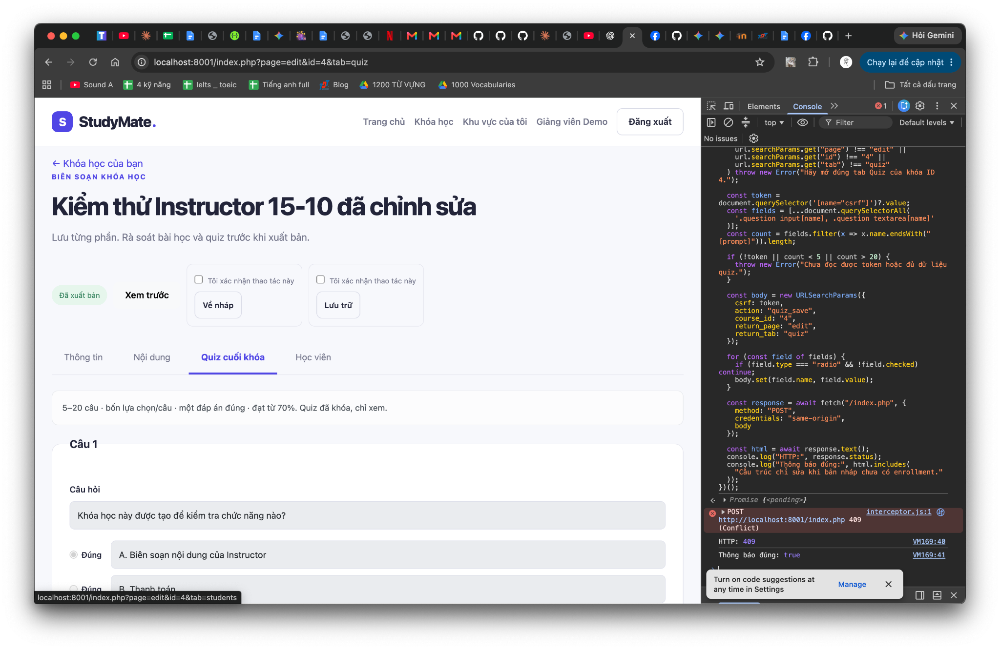

#### B3 — Khóa nháp ID 5: chương B thứ tự 2, chương A đã sửa thứ tự 3

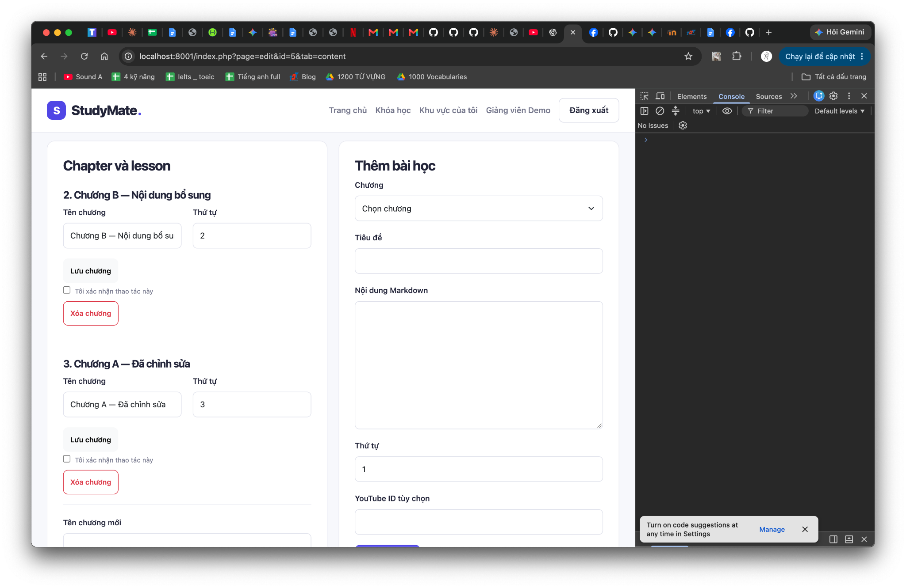

#### B4 — Chương B: bài B2 thứ tự 2 đứng trước bài B1 đã sửa thứ tự 3

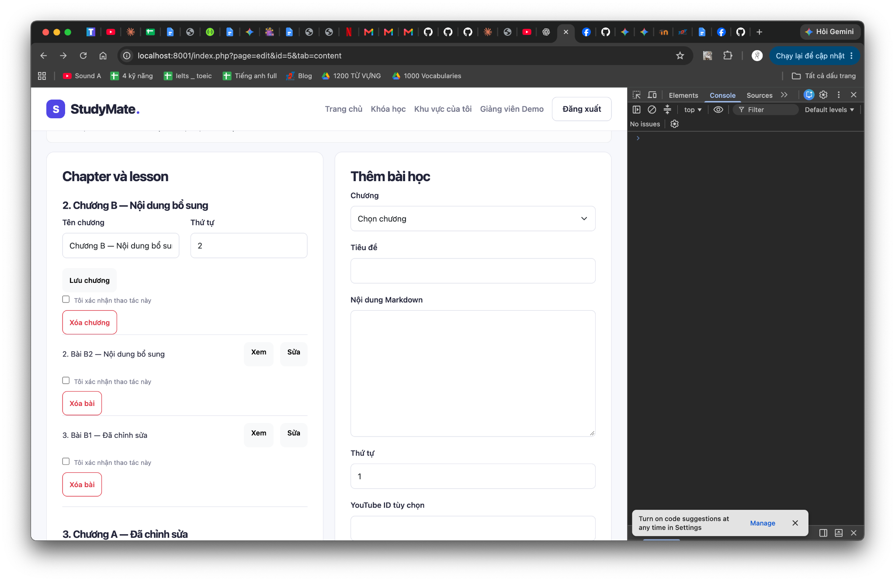

#### B5 — Câu 1 có prompt và giải thích mới; chọn Instructor là đáp án đúng

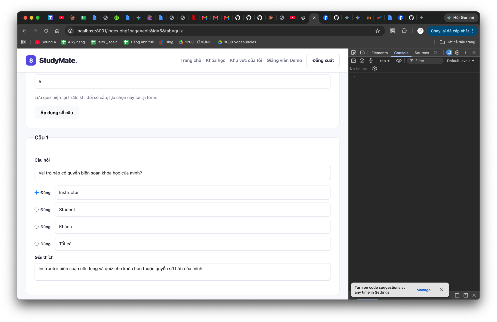

#### B6 — Quiz 4 và 21 câu: HTTP 422, thông báo đúng true

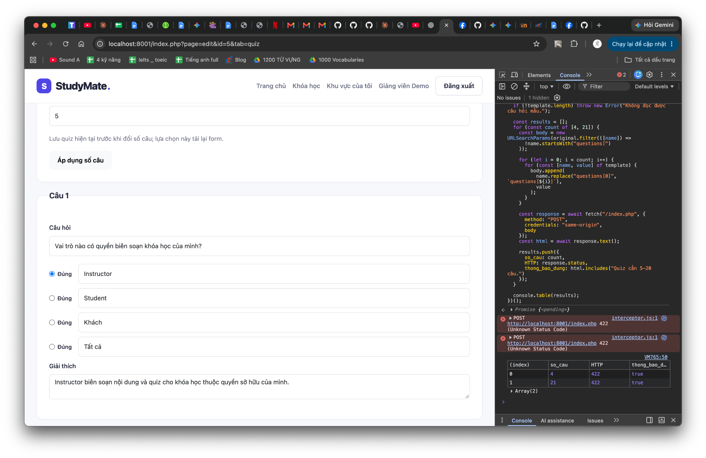

#### B7 — Trang quiz tại URL không có count hiển thị nội dung đến Câu 20

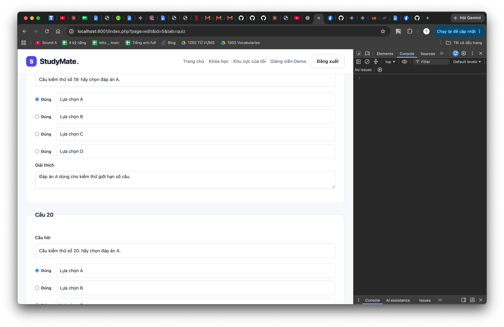

#### B8 — Lưu quiz thành công; URL không có count; Console đếm 5 câu

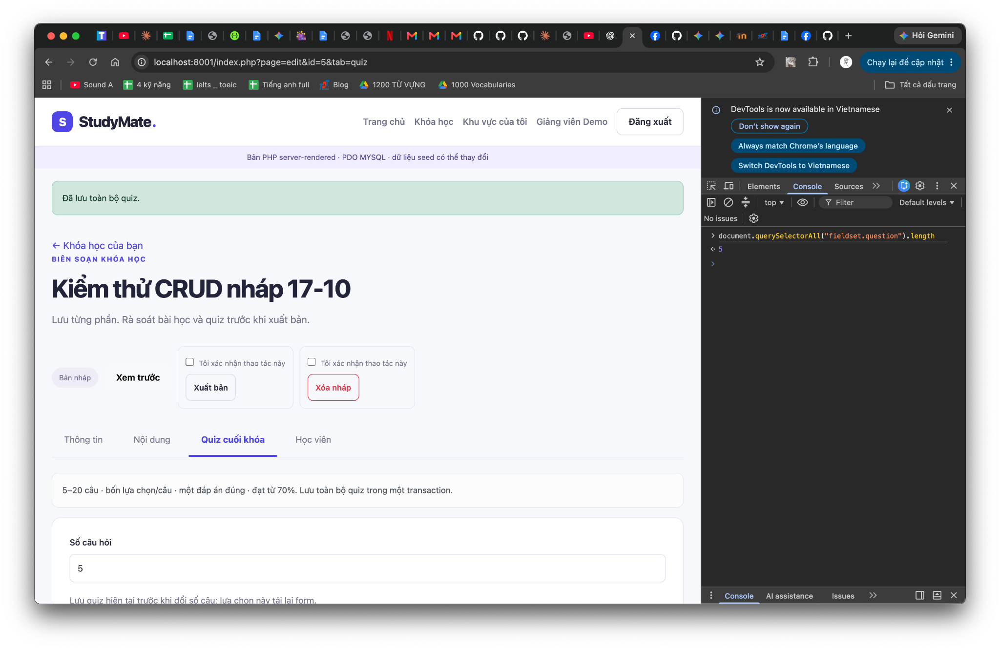

#### B9 — Năm trường hợp dữ liệu quiz sai: HTTP 422, thông báo đúng true

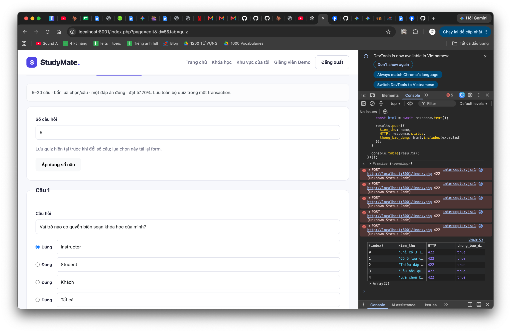

#### B10 — Thiếu và sai CSRF khi lưu quiz: HTTP 419, thông báo đúng true

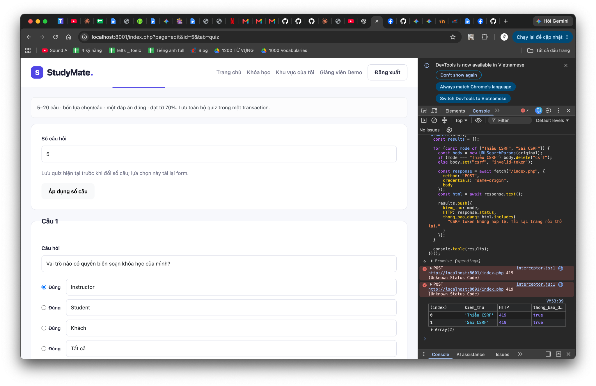

#### B11 — Mở lại trang quản lý ID 5: Không tìm thấy khóa học

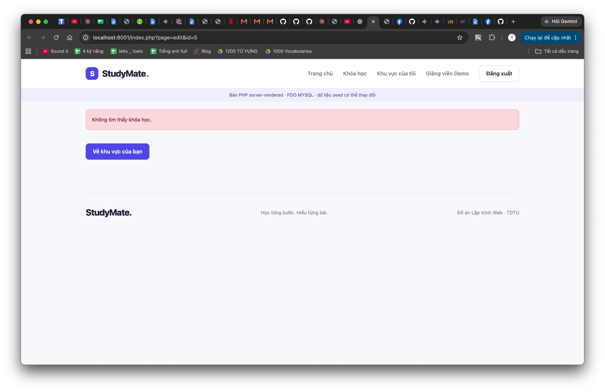

#### B12 — Khóa ID 4 vẫn mở được, tên giữ nguyên và trạng thái Đã xuất bản

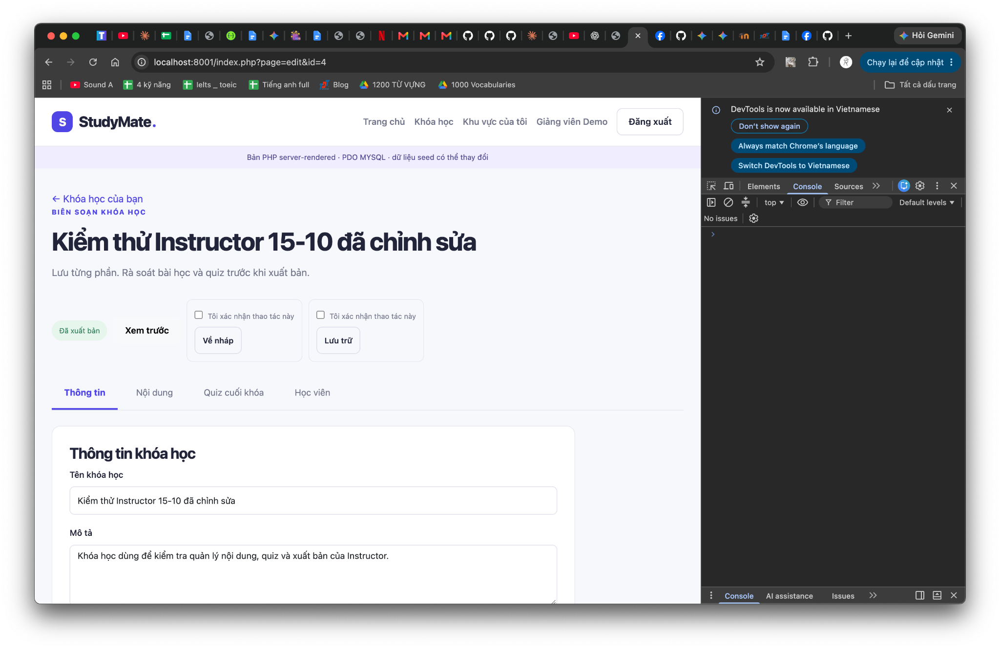

### 10.4. Kết luận của đợt bổ sung

Các ca đã thực hiện cho thấy server chặn những yêu cầu thay đổi cấu trúc/quiz được thử trên khóa đã đóng, cho phép biên soạn trên khóa nháp, từ chối những dữ liệu quiz sai được liệt kê và kiểm tra CSRF ở action quiz_save. Khóa thử ID 5 đã bị xóa; trang quản lý khóa ID 4 vẫn mở được.

Chưa kết luận kiểm thử toàn bộ phân quyền/CSRF, tính nguyên tử khi nhiều request đồng thời, không còn dữ liệu mồ côi sau xóa, mọi giới hạn độ dài hoặc nghiệm thu đầy đủ bản main. Các phần còn mở được giữ ở mục 8.

