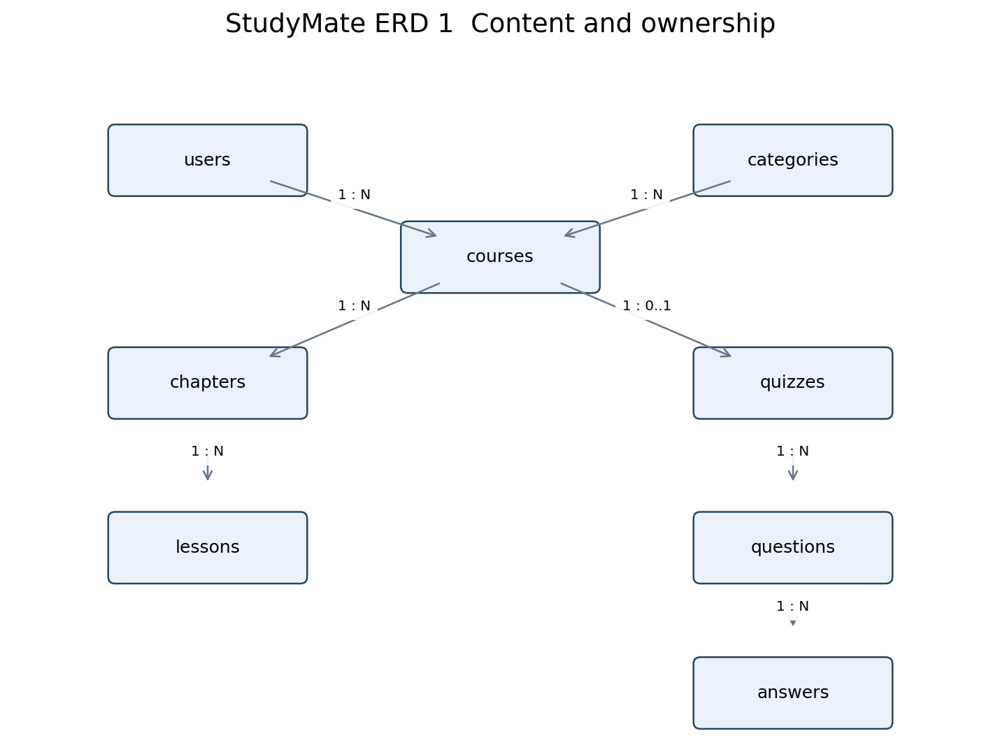
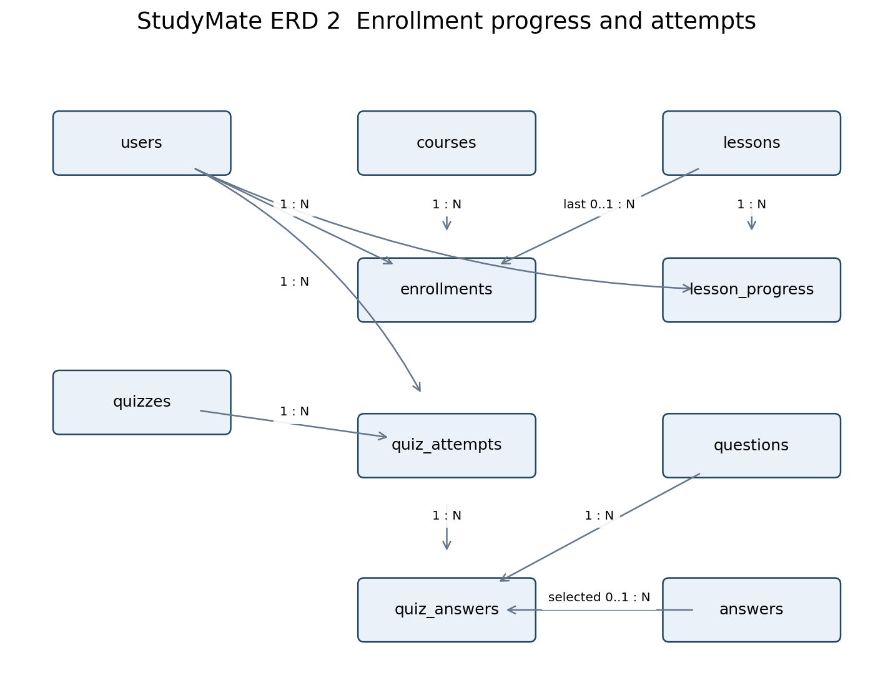

# Đặc tả yêu cầu StudyMate

Phiên bản 2.2 • Ngày 12/10/2026 • Phạm vi triển khai trong 3 tuần

StudyMate là website học tập với khóa học, bài học, quiz luyện tập và trợ lý AI theo nội dung bài. Phiên bản này chốt phạm vi và quy tắc để ba thành viên triển khai song song, nghiệm thu được và không phát sinh các chức năng ngoài kế hoạch.

### Bài toán và mục tiêu

Người học cần một nơi tập trung nội dung khóa học, ghi nhận bài đã học, luyện tập và xem lại kết quả. StudyMate cung cấp chuỗi học bài → đánh dấu hoàn thành → quiz → giải thích AI theo bài, giúp theo dõi việc học mà không dùng bảng tiến độ thủ công.

### Người dùng mục tiêu

Student là sinh viên hoặc người tự học các kiến thức nhập môn CNTT. Instructor là người biên soạn nội dung và quiz cho khóa mình sở hữu. Admin quản lý category, trạng thái tài khoản và khóa học. Khách xem catalog/outline công khai. Không hỗ trợ dạy trực tiếp hoặc tổ chức thi có giám sát.

### Mục tiêu đo được

Bản bàn giao phải hoàn thành luồng tạo/publish khóa, enroll, học, quiz, xem kết quả, hỏi/tóm tắt AI và quản trị theo FR01–FR12. Điểm quiz/tiến độ là chỉ báo luyện tập; không chứng nhận đã xem video hoặc năng lực thực tế.

## 1 Cơ sở thực hiện và thẩm quyền

StudyMate sử dụng PHP thuần dựng HTML trên server, PDO và MySQL. Baseline yêu cầu 2.2 áp dụng cho bản hoàn tất ngày 01/11/2026. Leader Nguyễn Minh Quân quyết định phạm vi; phân công và mức giờ giữ nguyên. Bản này thay kiến trúc React/Laravel bằng PHP thuần.

Phân công hiện tại được giữ nguyên. Mỗi thành viên chịu trách nhiệm kiểm thử module và bàn giao theo Project Specification.

## 2 Thứ tự tài liệu

SRS là nguồn chuẩn về hành vi, quyền, dữ liệu và nghiệm thu. Project Specification là nguồn chuẩn về kiến trúc triển khai, hợp đồng form/action/HTTP, phân công và lịch. Khi phát hiện khác biệt, dừng phần bị ảnh hưởng, sửa hai tài liệu trong cùng PR trước khi merge code. Quân quyết định phạm vi; thay đổi kỹ thuật liên quan module nào phải được chủ module review.

Không áp yêu cầu riêng của đề tài ghi chú trong FinalProject lên StudyMate. Các yêu cầu nộp bài thực tế từ giảng viên được Quân kiểm tra đầu tuần 1; không tự suy ra thang điểm hoặc hạn nộp chính thức từ kế hoạch nội bộ này.

## 3 Kết quả cần bàn giao

Một bản chạy trọn luồng tạo khóa học → đăng ký học → hoàn thành bài → làm quiz → xem kết quả → hỏi AI. Kèm mã nguồn, schema PDO/seed PHP, hướng dẫn chạy, tài khoản demo, bằng chứng kiểm thử và tài liệu thuyết trình. Đích chạy chuẩn là Docker Compose trên máy chấm; không phụ thuộc hosting trả phí.

## 4 Phạm vi được chốt

| **Nhóm**   | **Bắt buộc trong bản nộp**                                                                                                         |
|------------|------------------------------------------------------------------------------------------------------------------------------------|
| Tài khoản  | Đăng ký Student, đăng nhập, đăng xuất, xem hồ sơ tối thiểu; ba role cố định; khóa/mở tài khoản.                                    |
| Khóa học   | Danh sách công khai, tìm tên, lọc category, phân trang, chi tiết; quản lý khóa học của Instructor.                                 |
| Nội dung   | Course → Chapter → Lesson; Markdown thuần, code block và video YouTube qua ID; không upload.                                       |
| Học tập    | Enrollment miễn phí; hoàn thành lesson; tiếp tục bài gần nhất; tiến độ và trạng thái hoàn thành.                                   |
| Quiz       | Một quiz cuối khóa; 5–20 câu; bốn lựa chọn/câu, một đáp án đúng; tự chấm và lưu từng lần nộp.                                      |
| Dashboard  | Student: số khóa đã tham gia/hoàn thành và tiến độ. Instructor: khóa học của mình và học viên. Admin: ba số đếm và quản lý cơ bản. |
| AI         | Hỏi đáp hoặc tóm tắt nội dung văn bản của lesson hiện tại; gọi qua backend; có quota và xử lý lỗi.                                 |
| Chất lượng | Phân quyền server, responsive, loading/empty/error, schema/seed, test và hướng dẫn chạy.                                           |

### Ngoài phạm vi của ba tuần

Không làm thanh toán/checkout, chứng chỉ, đánh giá khóa học, wishlist, notifications, email xác thực/khôi phục mật khẩu, đổi role trên giao diện, upload ảnh/PDF/video, bài tập lập trình có thực thi, timer thi, ngân hàng đề, gamification, leaderboard, dark mode, PWA/offline sync, realtime, tìm kiếm ngữ nghĩa hoặc AI đọc file/video.

Profile chỉ hiển thị tên, email và role; không có màn hình chỉnh sửa hay avatar upload. Admin không có dashboard báo cáo nâng cao. Không phát triển trang rỗng hay nút giả cho tính năng ngoài phạm vi.

### Giới hạn vận hành đã công bố

Khóa học miễn phí, giao diện tiếng Việt, mỗi tài khoản một role. Quiz là luyện tập và cho làm lại; không được giới thiệu là kỳ thi chống gian lận. Tiến độ do người học đánh dấu, không chứng minh đã xem hết video. AI có thể sai và phụ thuộc mạng/quota; sự cố AI không chặn học hoặc quiz.

Không bổ sung tính năng tùy chọn trong lịch cơ sở. Ý tưởng mới được đưa vào backlog sau bản nộp. Chỉ mở lại phạm vi khi Quân chấp nhận thay đổi có tác động và phần việc thay thế rõ ràng.

## 5 Vai trò và kiểm soát truy cập

| **Hoạt động**                      | **Khách** | **Student** | **Instructor** | **Admin** |
|------------------------------------|-----------|-------------|----------------|-----------|
| Xem catalog và outline published   | Có        | Có          | Có             | Có        |
| Học và lưu tiến độ                 | Không     | Đã enroll   | Không          | Không     |
| Làm quiz và hỏi AI                 | Không     | Đã enroll   | Không          | Không     |
| Xem trước toàn bộ nội dung         | Không     | Không       | Khóa của mình  | Mọi khóa  |
| Sửa nội dung và đề quiz            | Không     | Không       | Khóa của mình  | Không     |
| Xem học viên và kết quả            | Không     | Của mình    | Khóa của mình  | Không     |
| Archive khóa học                   | Không     | Không       | Khóa của mình  | Mọi khóa  |
| Quản lý category và khóa tài khoản | Không     | Không       | Không          | Có        |

### BR01 Tài khoản và phiên

Tự đăng ký chỉ tạo Student đang hoạt động. Instructor và Admin tạo bằng seed; không có endpoint đổi role. Email được trim và chuyển chữ thường; duy nhất trong DB. Tên 2–80 ký tự; email tối đa 254; mật khẩu tối thiểu 10 ký tự và tối đa 72 byte UTF-8, nhập xác nhận; dùng password_hash/password_verify với bcrypt cost 12. Không lưu mật khẩu plaintext hoặc ghi mật khẩu vào log.

Native PHP session cookie HttpOnly/SameSite=Lax/Secure khi HTTPS; không JWT/localStorage. Idle timeout 120 phút, không Remember me. Login tái tạo session ID/CSRF; logout xóa phiên hiện tại và tái tạo ID/CSRF. Khóa hoặc mở user tăng auth_version, mọi phiên cũ không hợp lệ từ request kế; mở khóa cần login lại. Sai email/mật khẩu trả thông báo chung.

### BR02 Phạm vi đối tượng

Kiểm tra xác thực, trạng thái active, role, ownership và enrollment ở backend. Khóa không thuộc Instructor hoặc attempt không thuộc Student trả 404. Sai role trả 403. Chưa enroll trả 403 cho tài nguyên học. Không dựa vào việc ẩn nút frontend để bảo vệ API.

Khóa tài khoản Instructor không tự archive khóa học của họ; Student đã enroll vẫn học được. Admin không khóa chính mình hoặc bất kỳ tài khoản Admin nào. Không xóa user trong MVP; không xóa lịch sử học.

### BR03 Công khai và riêng tư

Catalog/detail công khai chỉ trả metadata và tên chapter/lesson, không trả nội dung bài, câu hỏi, đáp án, email học viên. Preview của chủ khóa và Admin không tạo enrollment, progress hoặc attempt.

## 6 Vòng đời khóa học và nội dung

### BR04 Trạng thái khóa học

draft → published → archived. Instructor được published → draft chỉ khi chưa có enrollment. Archived có thể published trở lại nếu hợp lệ. Khóa published xuất hiện công khai và nhận enrollment mới; archived ẩn khỏi catalog nhưng học viên cũ tiếp tục học, quiz, AI. Admin chỉ archive; khôi phục do Instructor sở hữu thực hiện.

Điều kiện publish: tên, mô tả và category hợp lệ; có ít nhất một chapter; mỗi chapter có ít nhất một lesson có nội dung; có đúng một quiz hợp lệ gồm 5–20 câu, mỗi câu bốn lựa chọn và một đáp án đúng. Khóa chưa đủ điều kiện trả 422 với danh sách lỗi.

### BR05 Sửa và xóa

Chỉ thêm/xóa/đổi position chapter, lesson và thay toàn bộ quiz khi draft chưa enrollment. Metadata course, tiêu đề chapter/lesson và body/video được sửa ở mọi trạng thái; sau enrollment chỉ sửa trình bày, không đổi mục tiêu kiến thức. Quiz gồm prompt, answers, explanation bất biến sau enrollment. Ma trận chỉnh sửa ở phụ lục A là quy tắc dùng chung UI và server.

Chỉ xóa cứng course khi draft và chưa có enrollment. Cascade chapter, lesson và đề của draft đó. Category đang được sử dụng không được xóa. Published/archived không được xóa trực tiếp. Mọi thao tác xóa có xác nhận trên UI.

Các thao tác enroll, chuyển trạng thái và sửa cấu trúc khóa cùng khóa hàng course trong transaction. Điều này ngăn enroll đồng thời với xóa hoặc sửa cấu trúc. UI khóa cấu trúc khi không phải draft hoặc đã có học viên; server vẫn kiểm tra độc lập.

### BR06 Nội dung và thứ tự

Mỗi course thuộc một category và một Instructor. Chapter/lesson dùng position là số nguyên dương; danh sách sắp position rồi id để ổn định khi trùng. Chỉnh position bằng ô số; không làm drag-and-drop.

Tên course 5–150 ký tự; mô tả 20–2.000. Tên chapter/lesson 2–150. Lesson body bắt buộc 50–12.000 ký tự; Markdown không cho raw HTML. Video là youtube_video_id tùy chọn, kiểm tra định dạng 11 ký tự; ứng dụng tự tạo URL nhúng, không nhận iframe/URL tùy ý. Không thực thi code trong code block.

Ảnh course dùng một trong các ảnh tĩnh có sẵn với cover_key nằm trong allowlist. Không tải ảnh từ URL do người dùng nhập. Chức năng học phải dùng được chỉ với văn bản nếu video bên ngoài bị lỗi.

## 7 Enrollment và tiến độ học

### BR07 Enrollment

Student active được enroll khóa published. Đăng ký là miễn phí, không có hủy enrollment trong MVP. Gửi lặp tạo đúng một bản ghi nhờ unique(user_id, course_id). Enrollment cũ vẫn trả về bình thường kể cả khóa đã archived; enrollment mới vào khóa archived bị từ chối 409.

### BR08 Tiến độ

Student bấm Đánh dấu hoàn thành, form POST có CSRF gửi tới PHP. Gửi lặp vẫn đúng một progress nhờ unique(user_id,lesson_id) và transaction. Không bỏ đánh dấu. Server kiểm lesson thuộc khóa đã enrollment.

lesson_progress_percent = round(100 × completed_lessons / total_lessons, 2). Draft không cho enrollment nên khóa có học viên luôn có ít nhất một lesson. Phần trăm 100 thể hiện hoàn tất nội dung, chưa tự động đồng nghĩa hoàn thành khóa học.

Student mở lesson bất kỳ trong khóa. Nút chuyển bài gửi POST last_lesson; server kiểm quan hệ rồi redirect GET learn. GET không tự ghi dữ liệu. Continue dùng last_lesson_id; nếu chưa có, chọn bài chưa hoàn thành đầu tiên, nếu hết thì bài đầu tiên.

### BR09 Điều kiện hoàn thành khóa

Khóa hoàn thành khi tất cả lesson đã hoàn thành và có ít nhất một attempt đạt tỷ lệ đúng từ 70%. Dùng tỷ lệ chưa làm tròn để xét đạt. Ghi enrollment.completed_at lần đầu đạt, không ghi đè khi làm lại điểm thấp. Không tạo certificate.

Progress và hoàn thành đều tính/kiểm tra ở server. Sau mỗi lần đánh dấu hoặc nộp quiz, service chung của Tú cập nhật trạng thái enrollment trong transaction. Client không gửi hoặc quyết định phần trăm, điểm hay completed_at.

### BR10 Dashboard

| **Role**   | **Dữ liệu hiển thị**                                                                                                                                                    |
|------------|-------------------------------------------------------------------------------------------------------------------------------------------------------------------------|
| Student    | Tổng enrollment; số enrollment có completed_at; từng course gồm progress, best_score_percent, last lesson và trạng thái.                                                |
| Instructor | Số khóa của mình; tổng enrollment của các khóa đó; bảng học viên theo khóa gồm tên, tiến độ, điểm tốt nhất và hoàn thành. Tổng enrollment không phải số người duy nhất. |
| Admin      | Số users, tổng courses, số published courses; bảng users, courses, categories. Không hiển thị chi tiết điểm cá nhân.                                                    |

## 8 Quiz luyện tập

### BR11 Cấu trúc đề

Mỗi course có một quiz cuối khóa. Quiz gồm 5–20 câu; prompt 5–500 ký tự; explanation 0–1.000; mỗi câu đúng bốn lựa chọn không rỗng, mỗi lựa chọn tối đa 250 ký tự; đúng một is_correct. Các câu trọng số bằng nhau; thứ tự cố định. Chỉ được cập nhật toàn bộ đề khi course draft và chưa có enrollment.

### BR12 Mở bài và nộp bài

Student chỉ lấy đề/nộp khi đã hoàn thành toàn bộ lesson của khóa. Không lưu attempt lúc mở đề; không timer, không lưu nháp. UI cảnh báo khi rời trang đang chọn đáp án. Refresh trước khi nộp có thể mất lựa chọn và phải được nêu trên màn hình.

Trang quiz Student không có is_correct/explanation. Form POST gửi request_id UUID và answers theo question_id; bỏ trống tính sai. Server kiểm question/answer thuộc quiz, không dùng điểm client.

Một lần nộp lưu quiz_attempts và quiz_answers trong transaction; ghi mọi câu của đề, với answer_id null cho câu bỏ trống. Điểm phần trăm làm tròn hai chữ số để hiển thị. passed = correct_count / total_questions ≥ 0,70. Lưu correct_count, total_questions, score_percent và passed do server tính.

### BR13 Nộp lặp và làm lại

request_id giữ nguyên khi retry cùng lần nộp; unique(user_id, request_id). Cùng request_id và payload chuẩn hóa giống nhau trả attempt cũ; khác quiz hoặc câu trả lời trả 409. Lưu submission_hash để đối chiếu. Nộp lại có chủ ý dùng request_id mới. Không tự động retry POST với UUID mới.

Cho phép làm lại không giới hạn; lưu lịch sử tất cả attempts. Student chỉ xem attempts của mình, gồm lựa chọn, đáp án đúng, explanation và điểm. Điểm tốt nhất xác định đạt; lần làm sau không làm mất hoàn thành. Quiz đã có enrollment không được sửa hoặc xóa nên lịch sử luôn diễn giải được.

### FR06 Nghiệm thu quiz

- Đề năm câu: đúng 3/5 trả 60% và chưa đạt; đúng 4/5 trả 80% và đạt.

- Trang quiz không lộ đáp án đúng; gửi score=100 không làm thay đổi cách chấm.

- Nhấn nộp hai lần hoặc retry cùng UUID chỉ có một attempt; sửa payload giữ UUID trả 409.

- Student khác không đọc attempt bằng cách thay ID; bài chưa học đủ không được lấy đề.

## 9 AI Study Assistant

### BR14 Hợp đồng sản phẩm

AI nằm trong trang Learning, gồm hai thao tác ask và summarize. Chỉ Student active đã enroll được dùng với lesson của khóa đó. Backend tự lấy body từ DB; bỏ qua mọi lesson text/system prompt do client tự gửi. Không truyền đáp án quiz, email, tên hoặc kết quả học vào provider.

Provider: Gemini Developer API generateContent qua PHP HTTPS stream. Model lấy từ GEMINI_MODEL (tương thích AI_MODEL); gemini-2.5-flash-lite chỉ là mặc định dự phòng chưa nghiệm thu với key thật, không cam kết còn khả dụng. Dùng free tier, ngân sách thanh toán 0 đồng, không bật billing. GEMINI_API_KEY chỉ ở config.php hoặc biến môi trường server; không commit hoặc gửi trình duyệt. Không agent framework/vector database. Quota thực tế phải được probe ngày đầu; không giả lập thành kết quả AI thật.

Mỗi yêu cầu AI độc lập chỉ lesson hiện tại/câu hỏi. PHP lưu kết quả trong session để render một lần rồi xóa; không DB history hoặc trí nhớ hội thoại. UI không ngụ ý AI nhớ các câu hỏi trước.

### BR15 Giới hạn và thất bại

Câu hỏi tối đa 1.000 ký tự; lesson body tối đa 12.000; output tối đa 600 token. Mỗi Student tối đa 5 yêu cầu/phút và 20/ngày; toàn ứng dụng tối đa 5/phút và 100/ngày, ngày tính Asia/Ho_Chi_Minh. Request bị chặn trước provider không trừ quota ngày; đếm cả request provider thất bại để hạn chế retry; kiểm tra quota bằng file lock flock với quota store ngoài public trước khi gọi.

Provider timeout 25 giây; form PHP chờ phản hồi và redirect, không streaming hoặc tự retry. Quota429, timeout504, thiếu key/provider503. Người học thử lại thủ công; AI lỗi không chặn học/quiz. Không dùng câu trả lời giả làm bằng chứng.

Quân cung cấp key và gọi thật ask/summarize D1. Free tier có thể giới hạn hoặc ngừng cung cấp; quota app không bảo đảm quota provider. Hết quota báo lỗi, không tự chuyển trả phí. FR10 chỉ nghiệm thu sau gọi provider thật. Tắt AI_ENABLED không ảnh hưởng học/quiz.

### BR16 Chất lượng câu trả lời

System instruction yêu cầu giải thích ngắn bằng tiếng Việt dựa trên bài, nói rõ khi nội dung bài chưa đủ và không làm theo chỉ dẫn thay đổi vai trò xuất hiện trong nội dung. Đây là biện pháp giảm lỗi, không bảo đảm AI đúng tuyệt đối. Hiển thị tên bài nguồn và lời nhắc kiểm tra lại kiến thức; render Markdown đã chặn raw HTML.

Không dùng kết quả AI để ghi điểm hoặc thay đổi nội dung course. Không tự động ghi toàn bộ prompt/response vào log; chỉ ghi latency và mã lỗi, không prompt/response. Không có lịch sử AI trong DB nghiệp vụ.

## 10 Danh mục yêu cầu chức năng

Các mã FR dưới đây là phạm vi bắt buộc. Chi tiết hành vi theo BR01–BR17; task và form/action tương ứng ở Project Specification. Một FR chưa qua tiêu chí nghiệm thu không được báo hoàn thành.

| **Mã** | **Chức năng** | **Điều kiện nghiệm thu tối thiểu**                                                                                            |
|--------|---------------|-------------------------------------------------------------------------------------------------------------------------------|
| FR01   | Tài khoản     | Đăng ký Student và tự đăng nhập; email trùng 422; login sai 401; logout hủy phiên; profile trả đúng role.                     |
| FR02   | Phân quyền    | Chặn sai role, sai owner, thiếu enrollment và tài khoản khóa tại server; không lộ tài nguyên riêng qua PHP handler công khai. |
| FR03   | Catalog       | Tìm tên không phân biệt hoa/thường; lọc một category; 12 item/trang; chỉ published; trạng thái rỗng rõ.                       |
| FR04   | Enrollment    | Enroll miễn phí, không trùng; trả My Courses đúng tài khoản; archived không nhận người mới.                                   |
| FR05   | Learning      | Mở bài, đánh dấu, refresh còn tiến độ; Continue Learning đúng last lesson; 100% nội dung tách khỏi hoàn thành.                |
| FR06   | Quiz          | Đề hợp lệ; tự chấm đúng; nộp lặp an toàn; lịch sử/đáp án đúng; đạt 70% và cập nhật hoàn thành.                                |
| FR07   | Instructor    | Tạo course/chapter/lesson/quiz, publish, archive, preview, xem học viên; giới hạn sửa đúng vòng đời.                          |
| FR08   | Admin         | Xem số đếm, khóa/mở user không phải Admin, archive course, CRUD category; chặn xóa category đang dùng.                        |
| FR09   | Dashboard     | Các số đếm, progress và best score lấy DB/PHP handler thật; không số liệu hardcode.                                           |
| FR10   | AI            | Ask/summarize có ngữ cảnh, key chỉ server; chặn sai quyền, giới hạn lượt; lỗi AI không chặn học.                              |
| FR11   | Giao diện     | Luồng chính dùng được ở 390, 768, 1366 px; loading/empty/error; label form; keyboard focus.                                   |
| FR12   | Bàn giao      | Clone sạch chạy theo README/Compose; schema/seed hoàn tất; syntax và test đạt; demo đủ ba role.                               |

### Điều kiện publish và dữ liệu mẫu

Seed gồm hai Student active, hai Instructor active, một Admin; ba course: một published chưa có enrollment, một published có tiến độ/attempt mẫu, một draft hợp lệ. Mỗi course hai chapter, mỗi chapter ba lesson và một quiz năm câu. Dữ liệu do nhóm biên soạn hoặc có quyền sử dụng. Mật khẩu demo lấy từ biến môi trường DEMO_PASSWORD, chỉ dùng trên môi trường demo.

## 11 Yêu cầu dữ liệu và tính toàn vẹn

Có 12 bảng nghiệp vụ; schema PDO và seed PHP, MySQL InnoDB utf8mb4. User thêm auth_version để thu hồi phiên. Session/quota dùng file ngoài public, không thêm bảng framework. SQLite local chỉ phục vụ demo/test, không thay MySQL cuối kỳ.

| **Bảng**        | **Quan hệ và ràng buộc chính**                                                                   |
|-----------------|--------------------------------------------------------------------------------------------------|
| users           | email unique; role student/instructor/admin; is_active; auth_version; không xóa user.            |
| categories      | name unique; một category có nhiều courses; restrict khi đang dùng.                              |
| courses         | instructor_id → users; category_id → categories; status; không xóa sau enrollment.               |
| chapters        | course_id → courses; position; sửa cấu trúc chỉ draft chưa enrollment.                           |
| lessons         | chapter_id → chapters; body, youtube_video_id, position.                                         |
| enrollments     | user_id + course_id unique; last_lesson_id nullable; completed_at nullable.                      |
| lesson_progress | user_id + lesson_id unique; completed_at; không bỏ hoàn thành.                                   |
| quizzes         | course_id unique; một course có tối đa một quiz.                                                 |
| questions       | quiz_id; prompt; explanation; position.                                                          |
| answers         | question_id; text; is_correct; position; bốn lựa chọn/câu.                                       |
| quiz_attempts   | user_id, quiz_id; request_id; submission_hash; điểm do server tính; unique user_id + request_id. |
| quiz_answers    | attempt_id + question_id unique; answer_id nullable; is_correct snapshot.                        |

### BR17 Giao dịch và truy vấn

Enrollment và lesson_progress dùng unique constraint cùng transaction để chống trùng. Nộp quiz ghi attempt, toàn bộ quiz_answers và enrollment.completed_at trong một transaction. Thao tác thay toàn bộ quiz nháp cũng là một transaction; sai một câu phải rollback cả đề.

FK không tự kiểm tra answer thuộc question hoặc last lesson thuộc course; PHP validator/service phải kiểm tra quan hệ này. Lưu timestamps UTC và trả ISO 8601; giao diện hiển thị Asia/Ho_Chi_Minh. Khóa ngoại/index cho các cột lọc user_id, course_id, quiz_id; eager loading để tránh truy vấn theo từng hàng.

### Bảo toàn lịch sử

Xóa course draft dùng cascade cây nội dung/quiz trong transaction và chỉ khi không có enrollment/attempt. Các khóa ngoại từ lịch sử dùng restrict. Không dùng xóa cứng để xử lý user bị khóa hoặc khóa học ngừng tuyển. Không reset/xóa dữ liệu cần giữ.

## 12 Chất lượng và nghiệm thu bản nộp

### NFR01 Bảo mật

PDO prepared statements; allowlist input; kiểm role/active/ownership trong PHP; CSRF cho thao tác thay đổi; session HttpOnly, SameSite=Lax và Secure khi HTTPS. Trang public không trả password hash, đáp án quiz hoặc email học viên. Login giới hạn 5 lần/phút theo email chuẩn hóa và IP; register 3 lần/phút/IP. Secret và stack trace không lộ ra client; APP_DEBUG=false trên bản demo.

### NFR02 Hiệu năng và giao diện

Mục tiêu kiểm thử trên cùng máy demo với 100 courses, 500 lessons, 100 users: 95% trong 30 lần tải trang catalog đã warm-up dưới 1 giây; ghi cấu hình máy và kết quả, không suy ra SLA sản phẩm. Danh sách phân trang; per_page mặc định 12, tối đa 50. AI/video không nằm trong chỉ tiêu này.

Kiểm tra Chrome và Edge bản có trên máy nhóm; ghi phiên bản khi nghiệm thu. Tại 390/768/1366 px không tràn ngang toàn trang; bảng riêng có thể cuộn ngang. Có label, thông báo lỗi sát trường, focus nhìn thấy, nút thao tác tối thiểu 44 px; không phụ thuộc hover.

### NFR03 Khả năng chạy lại

Document root public/; PHP Apache và MySQL qua Docker Compose là đường bàn giao chuẩn. PHP built-in server hỗ trợ local. SQLite PDO là chế độ local/test tùy chọn, không thay kiểm thử MySQL. README có lệnh setup, .env.example, seed và health check. PHP/MySQL image tag được chốt sau clean build; không commit config.php, .env, storage/sessions/quota hoặc DB. Test dùng database studymate_test riêng.

### Cổng nghiệm thu bắt buộc

- Tất cả FR01–FR12 có bằng chứng; test quyền, enrollment trùng, progress trùng, quiz đúng và nộp lặp đều đạt.

- Không còn lỗi làm mất dữ liệu, lộ quyền/secret hoặc chặn luồng demo; lỗi giao diện nhỏ được ghi trong known issues với cách tránh.

- Một thành viên không làm setup tự clone và chạy; không cần hỏi thêm lệnh hoặc dữ liệu cấu hình.

- AI được kiểm thử thật khi có key; thiếu key chỉ được xác nhận xử lý lỗi, không được tính là đã nghiệm thu AI.

- Kịch bản demo: Instructor tạo/publish → Student enroll/học/quiz/AI → Admin quản trị → minh họa một truy cập bị chặn.

### Quản lý thay đổi

Baseline 2.2 có hiệu lực cho triển khai. Lỗi cần sửa được tạo issue ngay. Mọi thay đổi scope, DB hoặc contract phải nêu lý do, tác động, người làm và kiểm thử; Quân phê duyệt scope, chủ module review kỹ thuật. Không cần họp lại cho quyết định đã ghi; không được âm thầm đổi contract để giải quyết cục bộ.

# Phụ lục A Ma trận chỉnh sửa và toàn vẹn

| Thao tác             | Draft chưa enroll   | Published hoặc archived chưa enroll | Đã enroll              |
|----------------------|---------------------|-------------------------------------|------------------------|
| Metadata và title    | Có                  | Có                                  | Chỉ sửa trình bày      |
| Body và video        | Có                  | Có                                  | Không đổi mục tiêu học |
| Thêm xóa và position | Có                  | Không                               | Không                  |
| Thay quiz            | Có                  | Không                               | Không                  |
| Xóa course           | Có nếu chưa attempt | Không                               | Không                  |

Published chưa enrollment phải unpublish trước sửa cấu trúc. Archived chưa enrollment phải publish rồi unpublish. Khóa có enrollment không mở lại cấu trúc; lỗi quiz xử lý bằng archive và tạo course mới thủ công. Một người khác phải rà soát quiz trước publish.

FK lessons.chapter_id CASCADE, tương tự chuỗi course/chapter/lesson và course/quiz/question/answer. FK từ lịch sử và last_lesson_id RESTRICT. CompletionService thuộc Tú là nguồn duy nhất quyết định completed_at; PHP learning/quiz handlers gọi trong transaction và khóa enrollment row. Không tính trạng thái hoàn thành ở frontend.

# Phụ lục B Use case chính

### UC01 Đăng ký và đăng nhập

Actor: Khách

Điều kiện trước: Chưa có phiên; email hợp lệ

Luồng chính: Nhập tên/email/mật khẩu/xác nhận → kiểm dữ liệu → tạo Student → login → mở dashboard.

Ngoại lệ: Email trùng 422; sai thông tin login 401; hết CSRF 419; user khóa 403.

Điều kiện sau: Phiên hợp lệ; role Student; không có quyền tự chọn role.

Truy vết: FR01 FR02

### UC02 Tạo và xuất bản khóa

Actor: Instructor

Điều kiện trước: Đăng nhập active, sở hữu course

Luồng chính: Tạo draft → chapter/lesson → quiz hợp lệ → reviewer rà nội dung → publish.

Ngoại lệ: Thiếu nội dung/quiz 422; sai owner 404; cấu trúc đã đóng 409.

Điều kiện sau: Course published; public chỉ thấy metadata/outline.

Truy vết: FR07

### UC03 Tìm và tham gia khóa

Actor: Student

Điều kiện trước: Đăng nhập active; course published

Luồng chính: Tìm/lọc → xem outline → enroll → My Courses → mở bài.

Ngoại lệ: Enroll lặp trả bản cũ; khóa archived chặn người mới 409; khách login rồi quay lại.

Điều kiện sau: Một enrollment duy nhất; archived vẫn học được nếu đã enroll.

Truy vết: FR03 FR04

### UC04 Học và tiếp tục bài

Actor: Student

Điều kiện trước: Đã enrollment

Luồng chính: Mở lesson → lưu last lesson bằng POST → đọc nội dung → đánh dấu → xem progress.

Ngoại lệ: Lesson ngoài course bị chặn; POST lặp không thêm record; refresh giữ tiến độ.

Điều kiện sau: Tiến độ server lưu; 100% nội dung chưa đồng nghĩa course completed.

Truy vết: FR05 FR09

### UC05 Làm quiz cuối khóa

Actor: Student

Điều kiện trước: Đã hoàn thành tất cả lesson

Luồng chính: Lấy đề không đáp án → chọn → submit UUID → server chấm → lưu mọi câu → trả kết quả → xem history/làm lại.

Ngoại lệ: Chưa đủ lesson 403; đáp án sai quan hệ 422; UUID cùng payload trả cũ; UUID khác payload 409; mạng lỗi retry giữ UUID.

Điều kiện sau: Một attempt mỗi lần nộp; đạt từ 70%; completed_at chỉ ghi lần đầu.

Truy vết: FR06 FR09

### UC06 Hỏi hoặc tóm tắt bài

Actor: Student

Điều kiện trước: Đã enroll; lesson có body; AI khả dụng

Luồng chính: Chọn ask/summarize → server lấy body → reserve quota → gọi Gemini → render câu trả lời và tên lesson.

Ngoại lệ: Quota 429; timeout 504; thiếu key/provider/safety block 503; không ảnh hưởng học/quiz.

Điều kiện sau: Không lưu lịch sử DB; không gửi đáp án/PII; refresh đổi bài xóa chat.

Truy vết: FR10

### UC07 Quản trị và phân quyền

Actor: Admin

Điều kiện trước: Đăng nhập active

Luồng chính: Xem dashboard → category CRUD hoặc khóa user hoặc archive course → xác nhận → server kiểm quyền.

Ngoại lệ: Không khóa Admin; category đang dùng 409; draft archive 409; thiếu quyền 403.

Điều kiện sau: Session user bị khóa bị xóa; lịch sử học giữ; archived vẫn phục vụ học viên cũ.

Truy vết: FR02 FR08

# Phụ lục C AI miễn phí và bàn giao

Gemini free tier có thể dùng nội dung để cải thiện sản phẩm. Chỉ gửi nội dung bài tự biên soạn công khai; UI nhắc không nhập thông tin riêng tư. Không gửi tên/email/điểm/đáp án. Quota app giữ 5/user/phút, 20/user/ngày, 5/app/phút, 100/app/ngày; kiểm atomic trước provider. Request bị chặn không trừ quota ngày, provider lỗi vẫn tính. Nguồn: https://ai.google.dev/gemini-api/docs/pricing và https://ai.google.dev/gemini-api/docs/rate-limits, kiểm tra 12/10/2026.

Bản hoàn tất ngày 01/11/2026. Hồ sơ bắt buộc nội bộ: source clone sạch có .git, PHP source/schema/seed/Compose/config example, Readme.txt/README, tài khoản demo, video 1080p ba người và đủ FR, test report/collection, SRS2.2/spec2.2, known issues và evidence GitHub hợp lệ. Rubric dùng bản giảng viên cấp; không tự áp 32 chức năng ghi chú hoặc tự gán điểm online/offline. Checklist và lịch chi tiết nằm trong Specification mục 14.

Kế hoạch 12/10–01/11 chỉ có ba tuần. Mỗi người hai meaningful commits mỗi tuần là mục tiêu nội bộ. Nếu giảng viên yêu cầu bốn tuần liên tiếp, ba tuần không đủ; leader ghi phản hồi chính thức và trạng thái bằng chứng trung thực. Yêu cầu chấm chưa được xác nhận không phải quyền tự miễn yêu cầu môn học.

# Phụ lục D Sơ đồ quan hệ dữ liệu

Sơ đồ tách thành hai phần để đọc rõ; bảng xuất hiện lặp là cùng một bảng. Mũi tên từ bảng cha tới bảng con. 1:N là một tới nhiều; 0..1 biểu thị liên kết tùy chọn. Schema có 12 bảng nghiệp vụ.

Course draft có thể chưa có quiz; publish bắt buộc đúng một quiz hợp lệ. Chapter/lesson và questions/answers có thể trống khi draft nhưng phải hợp lệ khi publish.

### Quan hệ học tập và lịch sử

quiz_answers.answer_id nullable cho câu bỏ trống. enrollments.last_lesson_id nullable trước khi học. Các FK từ lịch sử RESTRICT; kiểm answer thuộc question và last lesson thuộc course bằng service. users.role quyết định ownership của Instructor hoặc quyền học Student.

# Phụ lục E Chuyển sang PHP thuần

Baseline 2.2 theo quyết định leader: không React, Vite, Node, Laravel hoặc Blade. PHP render HTML; form GET tìm/đọc, POST có CSRF đổi dữ liệu, redirect 303 sau thành công. URL index.php?page=...; role/owner/enrollment được kiểm tại server. MySQL là CSDL cuối; SQLite local/test được hỗ trợ riêng.

Phân công và giờ giữ nguyên: An public/Student templates và CSS; Quân Instructor/Admin/AI; Tú PDO/schema/session/học/quiz/runtime. Bảng file owner, lịch 3 tuần và checklist ở Specification2.2. Không phát triển hai frontend song song.

Phiên bị thu hồi bằng auth_version thay xóa vật lý file session. Quota dùng flock một host. UI xác nhận bằng checkbox bắt buộc, server kiểm; không modal JavaScript. Markdown hỗ trợ heading/paragraph/code an toàn, chưa full CommonMark. Catalog phân trang12; danh sách quản trị/roster cần hoàn thiện phân trang và aggregate trước performance gate.

Bản PHP đã kiểm tra syntax/service/browser với SQLite; chưa nghiệm thu MySQL/concurrency/Gemini thật/Compose. Các mục này phải đạt riêng trước khi báo hoàn thành FR tương ứng. PDF ảnh viewport chưa có addressbar phải chụp lại trên máy để nộp theo yêu cầu bài frontend.

## Cập nhật nghiệm thu kỹ thuật 27/10/2026

Giới hạn được đối chiếu với validation server: mô tả 20–2.000 ký tự, lesson body 50–12.000. Cấu hình model dùng `GEMINI_MODEL`, tương thích `AI_MODEL`; mặc định dự phòng `gemini-2.5-flash-lite`, phải probe với key thật. Student/Instructor/Admin/roster phân trang mặc định 12, tối đa 50, giữ query filter, tổng số toàn tập; tiến độ/điểm tốt nhất được tổng hợp theo course/user. Bằng chứng mới và các phần chưa nghiệm thu (Gemini thật, Chrome/Edge, review/merge/rubric/video/nộp bài) xem FINAL_ACCEPTANCE.md. Đây là cập nhật đối chiếu hiện thực để nhóm review, không tự xác nhận đã đạt mọi FR.
